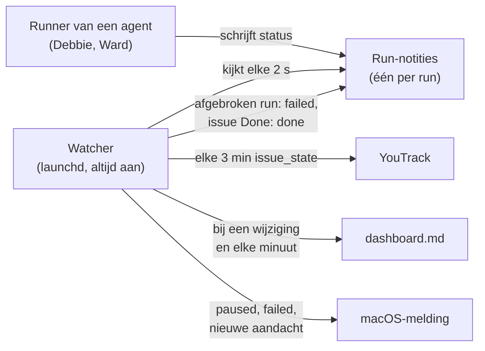

# Agents-dashboard

In `gebieden/agents/dashboard.md` zie ik in één notitie wat mijn autonome agents nu doen, wat ze de
afgelopen week deden en wat op mij wacht. Het dashboard loopt hooguit een paar seconden achter op
de run-notities, en een paar minuten op YouTrack. De agents nu: [[debbie]] (Dependabot-routine) en
[[ward]] (bewaking van de hosts).

Waarom het zo werkt: [[agents-dashboard-beslissingen]]. Hoe het zo gekomen is:
[[agents-dashboard-logboek]]. De afspraak voor run-notities: [[agent-runs]].

## Hoe het samenhangt

## Wat het dashboard toont

Van boven naar beneden:

- **De watcher draait niet** (rood), alleen als de heartbeat ouder is dan 3 minuten. Dan ververst
  het dashboard niet meer; zie `Beheer`.
- **Aandacht nodig** (rood): elke run die op mij wacht, met de reden of de aandachtspunten, het issue
  en het commando om te hervatten. Staat er niets, dan **Niets wacht op jou** (groen).
- **Stil** (oranje): een agent die langer dan zijn `interval` geen run is begonnen, zoals Debbie na
  8 dagen, of bij een interval per onderwerp een onderwerp dat te lang stil is, zoals
  `Fien · npm` na 4 dagen. Dan draait er waarschijnlijk iets niet.
- **Nu bezig** (blauw): de lopende runs, met sinds wanneer.
- **Afgelopen 7 dagen**: per agent een tabel met de laatste run per onderwerp (status als icoon,
  start, issue, kosten). ⚠️ is een `done`-run met aandachtspunten op een open issue.

Een run wacht op mij als hij niet loopt, niet is afgehandeld, en `paused` of `failed` is of
aandachtspunten heeft. Afgehandeld is: het issue staat op `Done`, of de run staat op `resolved`.

## Wat ik doe

Een punt onder `Aandacht nodig` afhandelen en het issue op `Done` zetten. Binnen 3 minuten is het
weg. Een run zonder issue geef ik vrij met `status: resolved` in de run-notitie, in Obsidian mag
dat. Hoe je een run van een agent hervat, staat in de notitie van die agent.

Elke melding komt één keer, bij een nieuwe status `paused` of `failed` of een nieuw aandachtspunt.
Wat al gemeld is, staat in `~/.agent-watcher/gemeld.json`, zodat een herstart niet alles opnieuw
meldt.

## Een nieuwe agent aansluiten

Watcher en dashboard hoeven niet te veranderen; Ward sloot zo aan.

1. Een notitie `gebieden/agents/<agent>.md` met `runs` (de map met run-notities) en eventueel
   `lijsten`, `interval` en `proces`, en in de tekst wat de agent doet en hoe je een run hervat.
2. De runner van de agent schrijft per run een notitie volgens [[agent-runs]], via
   `scripts/agentruns.py` (atomair, leest ook wat Obsidian schreef). Hij zet `resume` al bij de
   start, en `pid` alleen tijdens `running`.
3. Melden, `issue_state` bijhouden en een afgebroken run op `failed` zetten doet de watcher. De
   runner doet alleen wat specifiek is voor zijn agent.

## Beheer

- **Watcher:** `scripts/agent_watcher.py`, onder launchd als `nl.crimsoncricket.agent-watcher`
  (`KeepAlive`, `RunAtLoad`; plist in `scripts/agent-watcher/`, met de hand gekopieerd naar
  `~/Library/LaunchAgents/`). Heartbeat en log in `~/.agent-watcher/` (`heartbeat`, `watcher.log`).
  Valt hij weg, dan start launchd hem binnen ongeveer 30 seconden opnieuw. De runner van Debbie
  meldt elk half uur als de heartbeat oud is.
- **Controleren:** `launchctl list | grep agent-watcher` (een pid in de eerste kolom) en
  `tail ~/.agent-watcher/watcher.log`. Een fout in een tik staat in de log; de watcher loopt door.
- **Met de hand genereren:** `/usr/bin/python3 -I scripts/agent_dashboard.py` (met `--agents` en
  `--uit` voor een test op een andere map).
- **`dashboard.md` staat niet in git** (`.gitignore`) en wordt nooit met de hand bewerkt.
- **YouTrack-code testen met `/usr/bin/python3`,** zoals launchd: de pyenv-`python3` in mijn shell
  heeft geen SSL.

## Waar alles staat

| Wat | Waar |
| --- | --- |
| Dashboard (gegenereerd) | `gebieden/agents/dashboard.md` |
| Afspraak voor run-notities | [[agent-runs]] |
| Notitie per agent | `gebieden/agents/<agent>.md` |
| Gedeelde module | `scripts/agentruns.py` |
| Dashboard genereren | `scripts/agent_dashboard.py` |
| Watcher en plist | `scripts/agent_watcher.py`, `scripts/agent-watcher/` |
| Heartbeat, log, wat gemeld is | `~/.agent-watcher/` |
