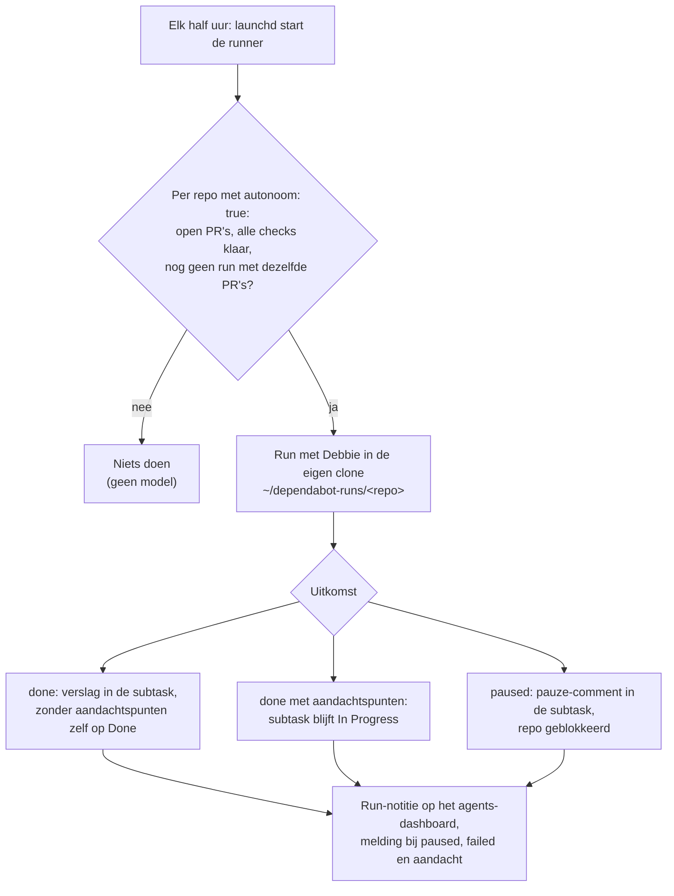

# Dependabot-routine

Elke week opent Dependabot (in `notifications` Scala Steward) PR's met dependency-updates in de 21
repo's van Pompkracht. De routine handelt ze af: groene PR's squash-mergen, de oorzaak van rode
PR's uitzoeken, `.sdkmanrc` bijwerken, een schone build draaien, kwetsbaarheden patchen zonder
breaking changes, alles in één eigen PR, de build op de base branch controleren en verslag doen in
een YouTrack-issue.

De routine is de skill `dependabot-routine`. Debbie is de agent die hem zelf start, zonder dat ik
een sessie open. Waarom het zo werkt: [[dependabot-routine-beslissingen]]. Hoe het zo gekomen is:
[[dependabot-routine-logboek]].

## Hoe een autonome run verloopt

1. **Selectie.** `scripts/dependabot_runner.py` kijkt met `gh` per repo of er open PR's zijn van
   de auteurs uit het projectbestand, en of alle checks klaar zijn. Er is geen model bij
   betrokken. Een repo met een lopende, gepauzeerde of mislukte run slaat hij over, net als een
   repo die deze week al een run had met dezelfde PR's (nummer plus commit). Een rebase door
   Dependabot geeft dus wel een nieuwe run.
2. **Run.** Per repo één run tegelijk, de repo's achter elkaar. Debbie draait op Opus 5.5 in
   `-p`-modus, met alleen de YouTrack-MCP en een vaste lijst toegestane commando's
   (`scripts/dependabot-runner/settings.json`). Ze stelt nooit een vraag: elk punt dat ze anders aan
   mij zou voorleggen, is een stop of een aandachtspunt in het verslag.
3. **Uitkomst.** Het verslag (`Debbie (Dependabot routine) report`) staat in de subtask in YouTrack.
   De runner schrijft de status in de run-notitie, niet het model.

Dependabot heeft per repo een vaste dag, dus er is bijna elke werkdag werk (maandag het meest, en
donderdag veel kleine npm-repo's). Een run kost meestal $0,60 tot $1,70 en duurt 2 tot 10 minuten.

## Wat ik moet doen

Op het agents-dashboard (`gebieden/agents/dashboard.md`) staat onder `Aandacht nodig` elke run die
op mij wacht. Ik krijg er ook een macOS-melding van.

- **Aandachtspunt bij een `done`-run:** iets waar ik een besluit over neem, zoals een
  kwetsbaarheid die alleen met een breaking fix weg kan, warnings in de build, of een rode PR met
  een voorstel. Afhandelen, en de subtask op `Done` zetten. Binnen een paar minuten is de run weg
  uit `Aandacht nodig`.
- **`paused`:** Debbie is gestopt en wacht. Het pauze-comment in de subtask zegt wat ze zag, wat ik
  moet beslissen, met een voorstel, en de stand (gemergede PR's, branch, base). Hervatten:
  - `Resume`: `cd ~/dependabot-runs/<repo> && claude --resume <sessie> "<mijn besluit>, continue
    from step <n>"`. Opent de sessie interactief. Bij een clone die de runner zelf aanmaakte,
    vraagt Claude eerst of ik de map vertrouw: ja.
  - `Fallback`, als de sessie weg is: `cd ~/dependabot-runs/<repo> && claude
    "/dependabot-routine <subtask>" --add-dir ~/vault`. Bouwt de stand op uit het pauze-comment.

  Na het verslag zet de runner de run op `done`. Zet ik de subtask op `Done`, dan doet de watcher
  dat.
- **`failed`:** de run crashte, liep over de time-out (120 minuten) of werd gestopt. Kijk in de log
  (`~/dependabot-runs/.logs/<run>.jsonl`) en hervat zoals bij `paused`.
- **Run zonder issue**, zoals een vuile clone of een fout in YouTrack vóór stap 0: oorzaak
  verhelpen en in de run-notitie `status: resolved` zetten. Dan is de repo weer vrij.

Een `paused`- of `failed`-run blokkeert alleen zijn eigen repo.

## Met de hand

In een project: `/dependabot-routine`. Dezelfde stappen, maar Debbie legt elk punt aan mij voor in
plaats van te stoppen. `/dependabot-routine <issue>` hervat een gepauzeerde run vanuit het issue,
`/dependabot-routine autonoom <issue>` doet dat autonoom.

## Beheer

- **Een repo aan of uit:** `autonoom: true` in de frontmatter van
  `.claude/skills/dependabot-routine/projecten/<repo>.md`. Regel weg, en de runner slaat de repo
  over. Met `--repo <naam>` draait de runner een project ook zonder `autonoom`, voor een test.
- **Een repo erbij:** projectbestand met `description`, `repo` (`Flow-Cloud-Systems/<repo>`),
  eventueel `authors` (standaard `[app/dependabot]`), de YouTrack-gegevens en eigen stappen. Dan
  `/usr/bin/python3 -I ~/vault/scripts/dependabot_runner.py --prepare --repo <naam>` in
  `env -i HOME=$HOME`: zet de clone klaar en toont welke Java, Maven, Gradle, sbt en Node de run
  krijgt.
- **Kijken wat de runner nu zou doen:** `dependabot_runner.py --dry-run`, per repo `run`, `wacht`,
  `overslaan` of `niets`.
- **De schedule:** `~/Library/LaunchAgents/nl.crimsoncricket.dependabot-runner.plist` (bron in
  `scripts/dependabot-runner/`). Herladen in twee stappen: `launchctl bootout
  gui/$(id -u)/nl.crimsoncricket.dependabot-runner`, controleren dat `launchctl print` de job niet
  meer vindt, dan `launchctl bootstrap gui/$(id -u) <plist>`. `launchctl kickstart
  gui/$(id -u)/nl.crimsoncricket.dependabot-runner` start hem meteen. Elke start zet een regel
  `-- <tijd>` in `~/dependabot-runs/.logs/runner.log`.
- **Een commando dat geweigerd wordt:** staat als `geweigerd` in de run-notitie, met het commando
  in de tekst. Alleen toevoegen aan `settings.json` als het niets kan schrijven buiten de clone en
  de scratch-map; anders liever de skill aanpassen.

## Waar alles staat

| Wat | Waar |
| --- | --- |
| De stappen | `.claude/skills/dependabot-routine/SKILL.md` |
| Per repo: YouTrack, autonoom, eigen stappen | `.claude/skills/dependabot-routine/projecten/<repo>.md` |
| Scripts van de skill (OSV, overrides, sbt) | `.claude/skills/dependabot-routine/scripts/` |
| Runner | `scripts/dependabot_runner.py` |
| Allowlist, MCP-config, omgeving, plist | `scripts/dependabot-runner/` |
| Run-notities | `gebieden/werk/dependabot-routine/runs/<jaar>-w<week>-<repo>.md` |
| De agent en de afspraak voor run-notities | [[debbie]], [[agent-runs]] |
| Clones, scratch-mappen, logs | `~/dependabot-runs/<repo>`, `.scratch/<repo>`, `.logs/` |
