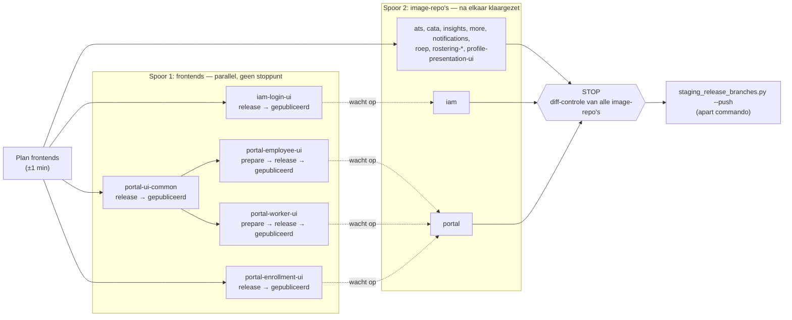

# Release candidates voor staging

Doel: het voorbereiden van release candidates voor een staging-uitrol stap voor stap
vastleggen, de herhalingen ontdekken en die gaandeweg automatiseren, net zoals bij
[[dependabot-routine]]. Uiteindelijk wordt dit een skill.

Gestart op 2026-11-12.

## Zo deed ik het tot nu toe

1. Het Pompkracht-bord van boven naar beneden aflopen. De swimlanes zijn hoofdissues
   (feature, bug of maintenance), met subtaken die bij verschillende repo's horen.
2. Per swimlane bepalen welke repo's erbij horen en daarvoor RC-builds maken.
3. In het infra-project zoeken naar een branch en worktree met het issuenummer en de
   suffix `rc`. Daarin staan configuratiewijzigingen die samen met die swimlane uit moeten.
4. De image tags van de RC-builds (= Docker image tags) in de juiste bestanden in die
   worktree zetten.
5. Eén PR naar `develop` van infra.

## Beslissingen

- **Altijd alle repo's van een vaste lijst.** Niet per swimlane selecteren: door Dependabot
  verandert er na een paar weken toch overal iets. Dat er geen half werk in `develop` staat,
  bewaak ik zelf.
- **Eén PR met alle image tags** naar `develop` van infra.
- **Configuratiewijzigingen in de `rc`-branches van infra mergen blijft handwerk.** Conflicten
  zitten vaak in secrets-bestanden die in hun geheel versleuteld zijn (één veld met de
  volledige properties van een applicatie). Oplossen kan alleen na decrypten en begrijpen.
- **Scripts eerst.** Wat deterministisch kan, gaat in een script in `scripts/`: dat scheelt
  tokens. Een LLM komt er alleen aan te pas waar die iets toevoegt.
- **"Nog niet uitgerold" = commits in `develop` die nog niet in `master` staan.**
- **Het overzicht van de hoofdissues komt op twee plekken:** eerst in een vault-notitie per
  uitrol om het te controleren, daarna in de beschrijving van de infra-PR.
- **De vaste lijst bestaat alleen uit repo's met een Docker image**, dus niet de lijst van de
  Dependabot-routine. Frontends die in een image meegaan, krijgen een echte release (geen
  RC) naar de private npm-repo. Die versie komt in de POM van het project dat het image
  bouwt, en dat gaat mee in de release branch:
  - `iam-login-ui` → `iam`
  - `portal-ui-common` → `portal-employee-ui` en `portal-worker-ui` → `portal`
    (een extra laag)
  - `portal-enrollment-ui` → `portal` (zonder `portal-ui-common`)
- **Tag `release candidate` op de hoofdissues** zodra de RC's gemaakt zijn. De
  Dependabot-skill slaat parents met die tag over, zodat Debbie daarna een nieuwe swimlane
  begint. Alles blijft op het bord tot de productie-uitrol; dan gaat de tag eraf. (Nog te
  bouwen: tag zetten in de RC-stap, en de zoekregel in de Dependabot-skill aanpassen.)
- **Configuratie in infra staat bovenaan in het overzicht**, want daar controleer ik het. Voor
  de rc-branches in infra maak ik nooit vooraf een PR; daar hoeft niet naar gezocht te worden.
- **Release branches via één generiek script in de vault**, met de verschillen per repo als
  configuratie in `data/staging-repos.json`. Geen just-recipe per project: er zijn geen
  programmerende collega's, en zo blijft het snel aan te passen zolang we nog leren. Het script
  werkt in schone clones (niet in `~/IdeaProjects`) en pusht met mijn eigen credentials, zodat
  `pre-release.yml` gewoon start. (Een CI-workflow die pusht met `GITHUB_TOKEN` zou dat niet
  doen.)
- **Eén stoppunt voor alle repo's, niet één per repo.** Het script bereidt alle release
  branches voor zonder te pushen en controleert per repo zelf of de diff alleen de versieregel
  en hoogstens de base-imageregel raakt. De samenvatting (afwijkingen bovenaan) komt in dezelfde
  notitie als het staging-overzicht: één controlemoment. Daarna één keer `--push`.
- **Het script pusht zelf, met een allow-regel op alleen dat script.** Geen algemene
  `git push`-toestemming voor Claude: in `.claude/settings.json` komt een allow-regel op
  `/usr/bin/python3 -I ~/vault/scripts/<release-script>.py`. Het script bepaalt wat er gepusht
  mag worden: alleen `release/*`-branches van repo's uit `data/staging-repos.json`, en alleen
  na een geslaagde diff-controle. Met de hand pushen is geen onderdeel van de werkwijze.
- **Het script maakt de release branches zelf, zonder gitflow-tools** (besloten 2026-11-13). Alle
  Maven-repo's hebben één `pom.xml`, dus de tools doen niets anders dan een branch vanaf
  `develop`, `-SNAPSHOT` van één regel afhalen en committen. Zelf doen is sneller (geen
  `sdk env`, geen Maven- of Gradle-start), voorkomt de CRLF-valkuil van `releaseStart` en geeft
  één codepad. De snapshot-controle van de plugins neemt het script over: na het aanpassen van
  de versie mag er geen `-SNAPSHOT` meer in de buildbestanden staan.
- **Eén commit per repo: "Prepare release X.Y.Z"**, met de versie en het base image samen. De
  berichten die per soort verschilden, vervallen.
- **Clones in `~/staging-runs/<repo>`**, naar het voorbeeld van `~/dependabot-runs`. Niet in
  `~/.cache`: tussen het klaarzetten en `--push` staat daar de enige kopie van de release
  branches en het state-bestand.
- **Verschillen per repo als configuratie in `data/staging-repos.json`:** per repo het bestand
  en de regex van de versieregel (bij npm alleen lezen uit `package.json`) en het bestand en de
  soort van het base image. De soorten (`temurin`, `node`, `node-slim`, `nginx-alpine`) staan één
  keer bovenaan, met de Docker Hub-repo, het tagpatroon en het patroon van de huidige regel.
- **Diff-controle per repo:** alleen de geconfigureerde bestanden veranderen, elke gewijzigde
  regel past voor en na in het verwachte patroon, en elke regex matcht precies één keer. Een
  repo die niet slaagt, slaat `--push` over. `--push` controleert ook dat de branch en
  `origin/develop` nog gelijk zijn aan de stand bij het klaarzetten, pusht alleen
  `release/X.Y.Z` (nooit `--force`) en verzamelt de RC-tags in de notitie en in JSON voor stap 5.
- **Frontendversies in de release branch van `iam` en `portal`** (besloten 2026-11-13), niet als
  losse commit op `develop`. Per repo staat in `data/staging-repos.json` onder `frontends` welke
  property bij welke frontend hoort. `staging_release_branches.py` haalt de versie uit
  `package.json` op `master` van de frontend (niet uit de dist-tag `latest`, die soms verkeerd
  staat in Nexus), vervangt alleen een X.Y.Z-waarde (de property bovenaan met `develop` blijft
  staan) en neemt die regels mee in de diff-controle. Staat de frontend in het plan van
  `staging_frontends.py` maar is hij nog niet gepubliceerd, dan slaat het de repo over.
- **Frontends zonder stoppunt, parallel; image-repo's met één gezamenlijk stoppunt** (besloten
  2026-11-13). `staging_release_branches.py` (klaarzetten) start de frontendketen uit
  `staging_frontends.py`: elke frontend in een eigen thread, die alleen wacht op de frontends die
  hij nodig heeft. Intussen worden de image-repo's zonder frontends meteen klaargezet; `iam` wacht
  alleen op `iam-login-ui`, `portal` op zijn drie frontends. Starten is niet pushen: alle
  image-repo's samen hebben één stoppunt met de diff-controle, en daarna één `--push`.
- **De frontendketen pusht en merget zelf**, onder de allow-regel van het releasescript, maar alleen
  bij frontends uit de config: `prepare-release/*` en `next-version/*` (nooit `--force`) en PR's naar
  `develop` en `master`, na groene checks. Automatische controles in plaats van een stoppunt:
  develop moet nog op de stand uit het plan staan, de diff mag alleen de verwachte regels raken,
  en de versie moet daarna precies zo in de npm-repo staan.
- **Volgorde in de frontendketen:** eerst publiceren, dan pinnen. "Prepare release" van
  `portal-employee-ui` en `portal-worker-ui` kan pas als `portal-ui-common` echt in de npm-repo
  staat. De versie wordt letterlijk ingezet (`npm install --package-lock-only --prefer-online
  pkg@X.Y.Z`, wat `^X.Y.Z` oplevert). "Update for next development version" volgt per frontend
  direct na zijn publicatie, behalve bij `portal-ui-common`: die wacht ook op employee en worker.
  Elke push naar `develop` van `portal-ui-common` start namelijk (via de dispatch na de build)
  `update-lock-file` in employee en worker, en dat zet `portal-ui-common` weer op `@develop`. Te
  vroeg zou dat de pin ongedaan maken voordat de release-PR gemerged is.
- **Hoofdissues worden afgeleid uit de commits.** Uit de issuenummers in de commits sinds de
  vorige release volg je de parent, en zo nodig weer de parent daarvan, tot je bij het
  hoofdissue uitkomt dat op het bord staat.

## Gewenste werkwijze (eerste schets)

Automatisch:

1. Per repo uit de vaste lijst een release branch maken en pushen. Dat gaat per project
   soms anders.
2. CI bouwt de RC en zet er een tag op. Die tags verzamelen.
3. Uit de commits per repo de hoofdissues afleiden en een overzicht maken: hoofdissue,
   repo's, issues.
4. Per hoofdissue zoeken of er in infra een `rc`-branch of worktree voor is.
5. Een PR naar `develop` van infra maken met alle image tags.

Handmatig (stoppunten):

- Het overzicht van de hoofdissues controleren: klopt het dat dit uitgerold wordt?
- De `rc`-branches van infra mergen en conflicten oplossen.

## Volgende stap

Stap 1 (overzicht) is klaar op 2026-11-12. Stap 2 (release branches) is klaar op 2026-11-13 voor
alle dertien image-repo's, waarvan acht via `staging_release_branches.py` (`iam` en `portal` samen
met de frontendketen). Alles staat in de uitrolnotitie [[2026-11-12]]. Start de volgende sessie in
`~/vault` met: "Ga verder met stap 5 (infra-PR) van [[release-candidates-staging]]". Volgende acties:

1. ~~Frontendketen, `iam` en `portal`~~: klaar op 2026-11-13, alle dertien RC's zijn er.
2. Stap 5: de infra-PR met alle image tags, uit `~/staging-runs/state.json` plus de vijf RC's die
   met de hand gemaakt zijn (zie de stand).
3. Als de werkwijze af is: deze planpagina omzetten naar duidelijke documentatie (werkwijze,
   schema, commando's), en het logboek en de afwegingen apart houden of inkorten.

Oorspronkelijke aanpak, ter referentie:

- Echte releases (geen RC) naar de private npm-repo van `iam-login-ui`, `portal-ui-common`,
  `portal-employee-ui`, `portal-worker-ui` en `portal-enrollment-ui`. `portal-ui-common` gaat eerst,
  want die zit in `portal-employee-ui` en `portal-worker-ui`.
- De nieuwe versies in de POM van `iam` (property `iam.login-ui.version` in het
  `pre-release`-profiel) en van `portal` (nog uitzoeken), en dan de release branches van `iam` en
  `portal`.
- Daarna bekijken of dit in het script kan (nu `"handmatig"` in `data/staging-repos.json`).
- Daarna stap 5: de infra-PR met alle image tags, uit `~/staging-runs/state.json` plus de vijf
  RC's die met de hand gemaakt zijn (zie de stand).

Stand op 2026-11-13:

- `ats` (Maven + plugin): klaar, RC `12.10.0-rc.0`.
- `insights` (Gradle zonder plugin): klaar op 2026-11-13, RC `1.31.0-rc.0`.
- `rostering-application` (Gradle + plugin): klaar op 2026-11-13, RC `1.13.0-rc.0`.
  `rostering-engine` heeft dezelfde plugin.
- `notifications` (sbt): klaar op 2026-11-13, RC `1.6.0-rc.0`.
- `rostering-api` (npm met image): klaar op 2026-11-13, RC `1.10.0-rc.0`.
- Via het script (2026-11-13): `cata` `4.16.0-rc.0`, `more` `3.16.0-rc.0`, `roep` `7.29.0-rc.0`,
  `rostering-engine` `1.13.0-rc.0`, `profile-presentation-ui` `1.21.0-rc.0`, `rostering-ui`
  `1.6.0-rc.0`.
- Via het script met de frontendketen (2026-11-13): `iam` `6.23.0-rc.0` (met `iam-login-ui` 1.1.0),
  `portal` `2.71.0-rc.0` (met employee 2.0.0, worker 1.1.0 en enrollment 2.0.0).
- De lokale checkouts van `ats`, `insights`, `rostering-application`, `notifications` en
  `rostering-api` staan op hun release branch, niet op `develop`.

## Open vragen

- Welke repo's staan precies op de vaste lijst? (Voorstel staat in het antwoord van
  2026-11-12; nog bevestigen.)
- Hoe maak je per project een release branch, en waar zitten de verschillen? (Maven met
  gitflow-maven-plugin, Gradle met een gitflow-plugin of met command-line git-flow; per repo
  vastleggen.)
- Frontend-releases: hoe komt de versie in de POM van `portal` (bij `iam`: property
  `iam.login-ui.version` in het `pre-release`-profiel)?
- Infra: hoe heet de repo, waar staan de worktrees, en welke bestanden bevatten de image tags?
- Hoe bepaal je "sinds de vorige release": vanaf `master`, of vanaf de laatste tag?

## Verloop van een run

Wat er parallel loopt en wat op elkaar wacht bij `staging_release_branches.py` (klaarzetten), en
waar het stoppunt zit:

Doorgetrokken pijlen: afhankelijkheden binnen een spoor en naar het stoppunt. Stippellijnen: de
enige plekken waar een image-repo op een frontend wacht. De image-repo's hangen onderling niet
van elkaar af; dat het script ze na elkaar klaarzet, is alleen de uitvoering (zie hieronder).

- Eerst het plan van de frontends (clones bijwerken, versies lezen, `npm view`). Daarna lopen
  twee sporen tegelijk: de frontends elk in een eigen thread, en in de hoofdlijn van het script
  de image-repo's na elkaar, eerst die zonder frontends en dan `iam` en `portal`.
- De sporen raken elkaar op maar twee plekken: `iam` wacht op `iam-login-ui`, en `portal` op
  employee, worker en enrollment. De andere image-repo's merken niets van de frontends.
- Binnen de frontends: employee en worker wachten op de publicatie van `portal-ui-common`. De
  volgende versie volgt per frontend direct na zijn publicatie; alleen die van `portal-ui-common`
  wacht ook op employee en worker (zie de beslissing over de volgorde). Die volgende versies
  staan niet in het schema; ze kunnen nog doorlopen terwijl ik de diffs bekijk. Het script
  wacht wel op ze voordat het de samenvatting schrijft.
- De frontends hebben geen stoppunt. Daar doen automatische controles het werk: de stand van
  `develop`, de diff, groene checks, en precies die versie in de npm-repo. Het enige stoppunt is
  de diff-controle van alle image-repo's samen. Daarna volgt `--push` als apart commando.
- Dat de image-repo's na elkaar worden klaargezet en niet parallel, is bewust: dat kost een paar
  seconden per repo (fetch, Docker Hub, één commit), terwijl de frontends minuten nodig hebben
  voor checks en builds. Spoor 2 staat dus het grootste deel van de tijd te wachten op `portal`;
  parallel klaarzetten zou nauwelijks iets schelen.

## Procedure

Per stap: wat ik doe, met welk gereedschap, en per repo of eenmalig.

1. **Overzicht maken** (script): `/usr/bin/python3 -I scripts/staging_overzicht.py --uit
   gebieden/werk/staging-releases/<datum>.md`. Daarna controleer ik het zelf (stoppunt).
2. **Release branches en frontends** (script, eenmalig): `/usr/bin/python3 -I scripts/staging_release_branches.py
   --uit gebieden/werk/staging-releases/<datum>.md`, na stap 1. Dit released ook de frontends
   (zonder stoppunt); `staging_frontends.py --plan` toont vooraf wat dat wordt. Daarna de sectie "Release
   branches" controleren (stoppunt) en daarna hetzelfde commando met `--push`. Hieronder de oude werkwijze met
   de hand, ter referentie.

   Met de hand (per repo):
   1. `master` en `develop` bijwerken (`git pull --ff-only`).
   2. `sdk env` (anders draait de verkeerde Maven- of Java-versie), dan de release branch
      maken met de gitflow-tool van het project. Die haalt `-SNAPSHOT` van de versie af en
      commit ("Update versions for release").
   3. Het base Docker image in het `pre-release`-profiel naar de nieuwste versie pinnen en
      committen ("Update base Docker image for production builds"). Dit is het enige wat in
      deze workflow wordt bijgewerkt; de parent doet Dependabot.
   4. Stoppunt: de diff `develop..release/X.Y.Z` controleren.
   5. Pushen. `pre-release.yml` leidt `X.Y.Z-rc.N` af, bouwt met Jib en zet de git-tag. Die
      git-tag is de image tag.

## Automatiseringskandidaten

| Stap | Wat herhaalt zich | Idee | Status |
| --- | --- | --- | --- |
| 2 | Nieuwste base image + digest opzoeken | Docker Hub tags-API, per soort een tagpatroon | klaar (`staging_release_branches.py`) |
| 2 | Release branch, pin, push, wachten op tag | één script voor alle repo's, in schone clones | klaar (`staging_release_branches.py`) |

## Logboek

### 2026-11-12, eerste ronde

- Vaste lijst bevestigd en vastgelegd in `data/staging-repos.json`. `portal-worker-ui` is ook
  een frontend van `portal`; `profile-presentation-ui` heeft een eigen image (Next.js).
- Lokale checkouts staan in `~/IdeaProjects/pompkracht/<repo>`, soms nog met de legacy-prefix
  `pk-`. Voor het overzicht zijn geen clones nodig (alles via `gh api`). Voor de release
  branches wel: eigen clones (zoals bij de dependabot-runner) of worktrees, nog te kiezen.
- Infra: repo `Flow-Cloud-Systems/infra`, branches `feature/<ISSUE>-rc` (en `-release` voor
  productie), worktrees naast de checkout als `infra-<ISSUE>-rc`.
- Stap 1 gescript: `scripts/staging_overzicht.py [--uit BESTAND]`. Per repo de commits van
  `master...develop` via de GitHub compare-API. Issuenummers in de commits worden alleen
  meegenomen als de projectkey in YouTrack bestaat (dat filtert `UTF-8` en dergelijke).
  De parents worden gevolgd via `parent(issues(idReadable))` in de YouTrack-REST-API. De
  infra-branches worden gekoppeld via `<ISSUE>-rc$`. Automatische updates (Dependabot, Scala
  Steward, de lock-file-commits van `portal-ui-common`) telt het script alleen; de overige
  commits zonder issue zet het per repo in een lijst.
- Eerste resultaat: [[2026-11-12]] in `staging-releases/`.
- Vergeleken met de hoofdissues op het bord:
  - Dependabot-parents zonder issuenummer in de commits (PM-359, PPP-75, ROEP-1063,
    RPAAS-487/489/491) ontbreken in het overzicht. **Besluit: geen probleem.** Bumps vervuilen
    het overzicht alleen en vragen nooit om configuratie. Commits zonder issue niet aan de
    Dependabot-parent hangen: het kan ook iets heel anders zijn.
  - PKI-906 ontbrak: de squash-commit was het issuenummer kwijt, de PR-titel en de branch
    (`feature/PPP-16`) hadden het nog wel. **Opgelost:** heeft een commit geen issuenummer maar
    wel `(#N)`, dan haalt het script het uit de titel en de branch van de PR.
  - PA-1096 (bug) was een hotfix die al in productie staat. De originele commit staat in
    `develop`, de cherry-pick in `master` (via "Hotfix 12.8.1"), die later terug is gemerged.
    **Opgelost:** commits met dezelfde titel als een master-commit sinds de oudste commit die nog
    niet uitgerold is, gaan naar een aparte sectie "Al in productie".
  - Op Done, niet op het bord, wel in het overzicht: PKI-1026, PKI-1034, PKIAM-819, PPP-79,
    PRC-47 (niet-functioneel, eerder van het bord gehaald) en PKI-1090 (script in `ats` zonder
    invloed op de applicatie). Klopt zo; het overzicht laat juist zien wat er echt meegaat.
- Debbie zette het issuenummer niet in de squash-commits van de Dependabot-PR's.
  **Aangepast in de Dependabot-skill:** `gh pr merge --squash --subject "<issue-id> <PR-titel>
  (#<n>)"` in stap 1 en stap 6. Zo blijft het nummer in de commit staan, en worden er minder
  commits als "zonder issue" getoond.
- Dependabot- en Scala Steward-hoofdissues (titel `… upgrades <jaar> w<bereik>`) staan in een
  aparte, compacte sectie onder de inhoudelijke hoofdissues.
- GitHub gaf bij een run herhaaldelijk een 503. `gh()` probeert het nu tot vijf keer, met
  steeds langere pauzes. Een PR-lookup die dan nog mislukt, verschijnt als waarschuwing
  bovenaan het overzicht, zodat een ontbrekend hoofdissue niet onopgemerkt blijft.
- Nieuwe sectie bovenaan: "Configuratie klaar in infra". Per rc-branch staan er het
  hoofdissue, of er commits in de repo's bij horen, hoeveel commits de branch voor en achter
  loopt op `develop` van infra, en welke bestanden erin gewijzigd zijn.
- De GitHub-API faalt soms kortstondig. Daardoor viel PKI-906 bij één run weer uit het
  overzicht. `gh()` probeert het nu drie keer, en een PR-lookup die echt mislukt, meldt het
  script op stderr.

### 2026-11-12, stap 2: `ats`

- Vorige release (`release/12.9.0`) nagekeken: twee commits, "Update versions for release" (de
  gitflow-maven-plugin) en "Update base Docker image for production builds" (met de hand).
- `ats`: Maven, gitflow-maven-plugin 1.21.0. `mvn -B gitflow:release-start` maakte
  `release/12.10.0` zonder vragen (de versie uit de POM, zonder `-SNAPSHOT`) en pusht niet zelf.
- Zonder `sdk env` draaide Maven 3.9.16 in plaats van 3.10.0 uit `.sdkmanrc`.
- Base image: `jib.from.image` in het `pre-release`-profiel van `eclipse-temurin:25.0.4_7-jdk`
  naar `25.0.5_8-jdk@sha256:b8705e93…`. Het veld `digest` uit
  `hub.docker.com/v2/repositories/library/eclipse-temurin/tags` is de multi-arch index: voor
  `25.0.4_7` gaf het precies de digest die al in de POM stond.
- Gepusht; run 43250762775 was groen. RC-tag **`12.10.0-rc.0`** (op `c6fb246c`).
- Lokale checkout was prima voor deze ronde. Bij automatiseren een schone checkout gebruiken.

### 2026-11-12, stap 2: `insights`

- Gradle (multi-module), geen gitflow-plugin; command-line `git flow` 0.4.1 met de config in de
  repo. Vorige release (`1.30.0`) had één commit "Update for the upcoming release": de versie in
  `gradle.properties` en het base image in `application/build.gradle.kts` (de tak
  `buildProfile == "preRelease"` in `jib.from.image`). Afgerond via een PR naar `master` (#236).
- `git flow release start 1.31.0`, daarna dezelfde commit met `1.31.0` en temurin `25.0.5_8`.
  Nog niet gepusht.
- Inventaris per soort: Maven + plugin (`ats`, `cata`, `iam`, `more`, `portal`, `roep`), Gradle +
  plugin (`rostering-application` `hyas.gitflow`, `rostering-engine` `libs.plugins.gitflow`),
  Gradle zonder plugin (`insights`), sbt (`notifications`), npm met image (`rostering-api`,
  `profile-presentation-ui`, `rostering-ui`).

### 2026-11-13, stap 2: `insights` gepusht

- `release/1.31.0` gepusht (`develop` was sinds gisteren niet veranderd). Run 43404376764 van
  "Pre-release build" was groen in ongeveer 5 minuten. RC-tag **`1.31.0-rc.0`** (op `ea99bee`).
- Claude kreeg geen toestemming voor `git push`, dus deze keer pushte ik met de hand via
  `! git -C … push`. Voor het script is dat geen optie; zie de beslissing over de allow-regel.

### 2026-11-13, stap 2: `rostering-application`

- Gradle 9.9.0 en Java 25.0.5 uit `.sdkmanrc`, plugin `com.hyas.gitflow` 1.0.2 (alias
  `hyas.gitflow`). `rostering-engine` heeft dezelfde plugin onder de alias `gitflow`. De
  taak heet `releaseStart`, zonder opties. Uit de bytecode blijkt dat hij niet pusht: hij
  controleert op snapshot-dependencies, haalt `-SNAPSHOT` van de versie in `gradle.properties`
  af, maakt `release/X.Y.Z` en commit "Updated gradle.properties for vX.Y.Z release".
- **Valkuil:** de commit van `releaseStart` nam ook `gradlew.bat` mee, CRLF → LF (globaal
  `core.autocrlf=input`, en het bestand staat met CRLF in de repo). Opgelost door de twee
  commits opnieuw te maken met `gradlew.bat` van `develop`. Het script moet dit opvangen: de
  diff-controle op alleen de versie- en base-imageregel vangt het, en het script zet
  `core.autocrlf=false` in zijn schone clones. Structureel: `.gitattributes` in `insights`,
  `rostering-api`, `rostering-application` en `rostering-engine` (PKI-1125, op het bord).
- Base image in `application/build.gradle.kts` (preRelease-tak van `jib.from.image`) van
  `25.0.4_7-jdk` naar `25.0.5_8-jdk@sha256:b8705e93…`. De Docker Hub-digest van `25.0.4_7`
  kwam overeen met de bestaande pin.
- `release/1.13.0` (`a26b3fc`, `5238682`) gepusht. Run 43406389260 van "Pre-release build" was
  groen in ongeveer 4 minuten. RC-tag **`1.13.0-rc.0`** (op `5238682`). De back-upbranch van
  voor de fix is weggegooid.

### 2026-11-13, stap 2: `notifications`

- sbt 2.0.12, geen gitflow- of `sbt-release`-plugin. Command-line `git flow` met de config in
  de repo, net als bij `insights`. De vorige release (`1.5.0`) had één commit "Update for the
  upcoming release": `ThisBuild / version` en de preRelease-tak van `jibBaseImage`, beide in
  `build.sbt`. Geen CRLF-bestanden in de index.
- `git flow release start 1.6.0` maakte alleen de branch. Daarna dezelfde commit (`d80de6e`) met
  `1.6.0` en temurin `25.0.5_8-jdk@sha256:b8705e93…`. Alleen `build.sbt` gestaged.
- Voor het script: dit is dezelfde soort als `insights` ("git flow + bestanden aanpassen"),
  alleen met andere bestanden en regex'en. Het verschil kan in `data/staging-repos.json`.
- Gepusht. Run 43407696727 van "Pre-release build" was groen in ongeveer 2 minuten. RC-tag
  **`1.6.0-rc.0`** (op `d80de6e`).

### 2026-11-13, stap 2: `rostering-api`

- npm (Node 24), command-line `git flow`. De versie in `package.json` staat op `develop` al op
  de releaseversie (`1.10.0`; npm kent geen `-SNAPSHOT`). Na de release zet "Update for next
  development version" de versie verder en de `Dockerfile` terug op `FROM node:24`. De release
  zelf is daardoor één commit: "Pin base Docker image".
- Base image: `FROM node:24` → `node:24.22.3@sha256:9d266751…` (Docker Hub, regex `24\.\d+\.\d+`).
- De oude pin (`node:24.21.0@sha256:64af38…`, gezet op 2026-09-22) is niet meer de digest die
  Docker Hub nu voor `24.21.0` geeft: de tag is op 2026-10-06 opnieuw gebouwd. De oude index
  bestaat nog. De digest onder een volledige versietag kan dus verschuiven; pinnen op de digest
  blijft daarom zinvol, en de controle "oude digest = Hub-digest" werkt niet voor node.
- Voor het script: bij npm de versie in `package.json` vergelijken met de branchnaam en alleen
  de `FROM`-regel aanpassen.
- `git flow release start 1.10.0`, commit `40f1928`, alleen de `Dockerfile` gestaged. Gepusht;
  run 43408965593 van "Pre-release build" was groen in ongeveer 2 minuten. RC-tag
  **`1.10.0-rc.0`** (op `40f1928`).

### 2026-11-13, stap 2: script, klaarzetfase

- `data/staging-repos.json` uitgebreid: bovenaan `versies` (maven, gradle, sbt, npm: bestand,
  regex van de versieregel, globs voor de snapshot-controle) en `images` (temurin, node,
  node-slim, nginx-alpine: Docker Hub-repo, tagpatroon, patroon van de huidige referentie,
  sjabloon). Per repo `versie`, `image` (bestand en soort) en bij `iam` en `portal` `handmatig`.
- `scripts/staging_release_branches.py [--repos A,B] [--uit BESTAND]`: clones in
  `~/staging-runs/<repo>`, state in `~/staging-runs/state.json`. Met `--uit` komt de samenvatting
  als sectie tussen markers in de uitrolnotitie (vóór de eerste `##`), en een volgende run
  vervangt die sectie. Let op: `staging_overzicht.py --uit` overschrijft het hele bestand, dus
  eerst het overzicht maken en daarna de release branches.
- Eerste run: `cata`, `more`, `roep`, `rostering-engine`, `profile-presentation-ui` en
  `rostering-ui` klaar voor push. De vijf repo's van vandaag kwamen als afwijking (release branch
  staat al op de remote), `iam` en `portal` onder "Met de hand". Diffs van `cata`,
  `profile-presentation-ui` en `rostering-engine` met de hand nagekeken: alleen de versie- en
  imageregel. `rostering-ui`: `nginx:alpine` → `nginx:1.31.8-alpine@sha256:713fc2eb…`.

### 2026-11-13, stap 2: script, `--push`

- `--push` gebouwd: per repo uit de state controleert het of de lokale branch en `origin/develop`
  nog dezelfde SHA hebben als bij het klaarzetten en of er geen release branch op de remote staat.
  Daarna pusht het alleen `refs/heads/release/X.Y.Z` (zonder `--force`). Het volgt de runs met
  `gh run list` (elke 30 seconden, maximaal 40 minuten) en haalt de RC-tag op die naar de gepushte
  commit wijst. Alles komt in `~/staging-runs/state.json` (de bron voor stap 5) en in de sectie
  in de uitrolnotitie.
- Allow-regel in `.claude/settings.json` op `/usr/bin/python3 -I …/staging_release_branches.py`
  (relatief, met `~` en absoluut). De deny op `git push*` blijft staan: alleen het script mag
  pushen.
- Eerste echte run: alle zes groen. RC's: `cata` `4.16.0-rc.0`, `more` `3.16.0-rc.0`,
  `profile-presentation-ui` `1.21.0-rc.0`, `roep` `7.29.0-rc.0`, `rostering-engine`
  `1.13.0-rc.0`, `rostering-ui` `1.6.0-rc.0`.
- De vijf repo's die vandaag met de hand gingen, staan in de uitrolnotitie onder "Afwijkingen"
  (release branch stond al op de remote). Hun RC's staan in de stand hierboven. Bij de volgende
  uitrol gaan ze gewoon door het script.

### 2026-11-13, frontendketen: inventaris (nog niets veranderd)

- Werkwijze tot nu toe (uit de geschiedenis van `portal-employee-ui`): (1) een PR "Prepare release"
  naar `develop` die `portal-ui-common` van een develop-build naar de releaseversie zet (alleen bij
  `portal-employee-ui` en `portal-worker-ui`), (2) een PR `develop` → `master` "Release X.Y.Z" met
  een merge-commit, waarna `master.yml` `npm publish --tag latest` draait, (3) een PR "Update for
  next development version" naar `develop`: minor-versie omhoog en `portal-ui-common` terug naar
  een develop-build. Geen git-tags, geen branch protection.
- De releaseversie staat al op `develop` (npm kent geen `-SNAPSHOT`): `portal-ui-common` 2.0.0,
  `iam-login-ui` 1.1.0, `portal-employee-ui` 2.0.0, `portal-worker-ui` 1.1.0,
  `portal-enrollment-ui` 2.0.0. Geen van deze versies staat al in de npm-repo. Alle develop-builds
  zijn groen.
- **Valkuil:** de dist-tag `latest` wijst bij alle vijf naar een develop-build (bijvoorbeeld
  `2.0.0-develop.fc37b2e`). Een publish vanaf `master` zet hem weer goed. Een releaseversie dus
  altijd uit `package.json` op `master` halen, niet uit `latest`.
- `portal`: de properties `ui.worker.version`, `ui.enrollment.version` en `ui.employee.version` in
  het `pre-release`-profiel (nu 1.0.0, 1.0.0 en 1.13.0); `download-ui.sh` doet `npm pack` op die
  versie. Bij de vorige keer stond de wijziging als losse commit op `develop` ("Upgrade employee
  UI", 2026-08-11). `iam`: `iam.login-ui.version` in het `pre-release`-profiel (nu 1.0.0).

### 2026-11-13, frontendketen: gescript

- `scripts/staging_frontends.py`: plan (alleen clones en `npm view`) en `--uitvoeren`. De volgorde
  komt uit de `in`-velden: `portal-ui-common` eerst, daarna `iam-login-ui` en `portal-enrollment-ui`,
  daarna employee en worker. Status in `~/staging-runs/frontends.json`, sectie tussen
  `<!-- frontends:start -->`-markers in de uitrolnotitie, boven de release branches.
- Of een versie gepubliceerd is, controleert het script met `npm view pkg@X.Y.Z version
  --prefer-online` (exacte versie, geen dist-tag). Het script stopt als `NPM_TOKEN` ontbreekt.
- Lokaal getest in de clone van `portal-employee-ui` (daarna teruggezet): de pin-stap met een
  bestaande develop-build als stand-in verandert één regel in `package.json` (plus de lock file),
  en `npm version 2.1.0 --no-git-tag-version` verandert alleen de drie versieregels. Een pin op
  1.1.0 faalt terecht: die heeft een peer dependency op react-notifications 3.
- `staging_release_branches.py`: `"handmatig"` bij `iam` en `portal` vervangen door `frontends`.
  De regex is getest op de huidige POM's: hij vindt precies één regel per property, die in het
  `pre-release`-profiel. De tabel met release branches heeft een kolom Frontends.
- Omgebouwd naar een graaf: `Keten` in `staging_frontends.py` draait elke frontend in een eigen
  thread met `threading.Event`s voor "gepubliceerd". `staging_release_branches.py` laadt de module
  via het pad (`importlib`, want `-I` zet de scriptmap niet op `sys.path`) en wacht per image-repo
  alleen op zijn eigen frontends. Droog getest met nep-stappen: `portal-ui-common`, `iam-login-ui`
  en `portal-enrollment-ui` starten tegelijk, employee en worker zodra `portal-ui-common`
  gepubliceerd is, en de volgende versie van `portal-ui-common` pas na employee en worker. Faalt
  `portal-ui-common`, dan stoppen employee en worker en krijgt `portal-ui-common` geen volgende
  versie; de rest gaat door.

### 2026-11-13, frontendketen: eerste echte run

- Gepubliceerd: `portal-ui-common` 2.0.0 (#45), `iam-login-ui` 1.1.0 (#34) en
  `portal-enrollment-ui` 2.0.0 (#37); de release-PR's naar `master` gingen goed. `iam` staat klaar
  voor push met `iam-login-ui` 1.0.0 → 1.1.0.
- **Mislukt:** alle PR's naar `develop` (prepare release van employee #257 en worker #56, volgende
  versie van iam-login-ui #35 en enrollment #38). De org-brede verplichte workflow "GitFlow Pull
  Request Validator" (`Flow-Cloud-Systems/.github`, `git-workflow.yml`) accepteert naar `develop`
  alleen `feature/*`, `hotfix/*` en `dependabot/*`. **Opgelost:** branches heten nu
  `feature/prepare-release-X.Y.Z` en `feature/next-version-X.Y.Z`. Daardoor bleef `portal` liggen
  en kreeg `portal-ui-common` terecht geen volgende versie.
- **Bug:** het releasescript schreef de sectie Frontends met zijn eigen markers, waardoor de
  uitrolnotitie door elkaar raakte. Met de hand hersteld; de keten schrijft nu zelf
  (`Keten.uitvoer`).
- **Aangepast:** een frontend die al in de npm-repo stond terwijl `develop` nog op die versie staat,
  krijgt alsnog de volgende versie (bij een herstart na een halve run).
- Herstart na het sluiten van de vier mislukte PR's: alles groen. Employee 2.0.0 en worker 1.1.0
  gepubliceerd (prepare #258/#57, release #259/#58). Volgende versies: `portal-ui-common` 2.1.0
  (#46, als laatste, na employee en worker), `iam-login-ui` 1.2.0 (#36), enrollment 2.1.0 (#39),
  employee 2.1.0 (#260), worker 1.2.0 (#59). `iam` (`release/6.23.0`) en `portal`
  (`release/2.71.0`) klaar voor push; diffs alleen versie, base image en frontendversies.
- `--push` van `iam` en `portal`: beide groen, RC's `6.23.0-rc.0` en `2.71.0-rc.0`. Daarna crashte
  het wegschrijven van de samenvatting: na de JSON-round-trip zijn de frontend-tuples lijsten
  (`% tuple(f)` opgelost). Opnieuw `--push` slaat gepushte repo's over en schreef alleen de
  samenvatting.
- Sectiemarkers als Obsidian-commentaar (`%% … %%`) geprobeerd en teruggedraaid: ook die zijn in
  Live Preview zichtbaar. De HTML-markers blijven; in de leesweergave zijn ze onzichtbaar.
