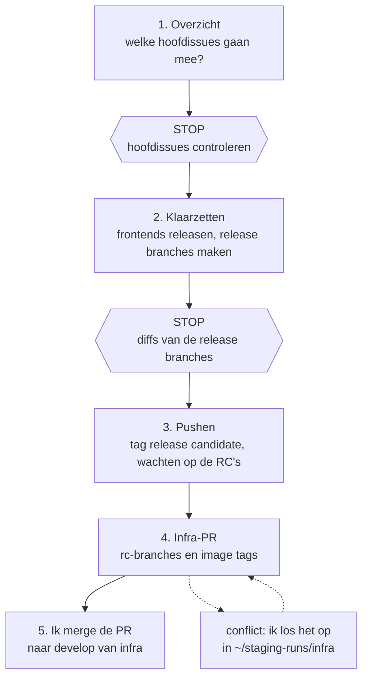
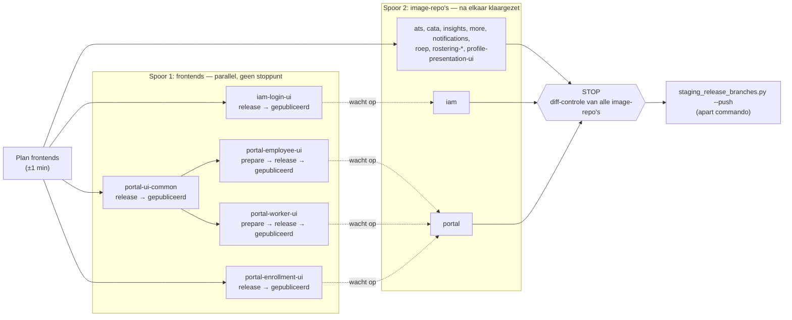

# Release candidates voor staging

Voor een uitrol naar staging krijgt elke Pompkracht-repo met een Docker image een release branch.
CI bouwt daar een release candidate (RC) van, en de image tags van die RC's gaan in één PR naar
`develop` van infra. Frontends die in een image zitten, krijgen eerst een echte release naar de
private npm-repo.

Ik start het met de skill `staging-release-candidates` ("bereid de release candidates voor
staging voor"). Scripts doen het werk; ik controleer op twee stoppunten en merge de PR zelf.

## Het proces

1. **Overzicht.** Per repo de commits in `develop` die nog niet in `master` staan. Via de
   issuenummers en hun YouTrack-parents komen daar de hoofdissues van het bord uit. Bovenaan staat
   de configuratie die in infra klaarstaat (`feature/<ISSUE>-rc`). Ik controleer of dit is wat ik
   wil uitrollen.
2. **Klaarzetten.** De frontends worden gereleased, zonder stoppunt maar met automatische
   controles. Intussen krijgt elke image-repo `release/X.Y.Z` vanaf `develop`: de versie zonder
   `-SNAPSHOT`, het base image gepind op de nieuwste tag met digest, en bij `iam` en `portal` de
   nieuwe frontendversies. Er wordt nog niets gepusht. Het script controleert zelf dat elke diff
   alleen die regels raakt; afwijkingen staan bovenaan in de uitrolnotitie.
3. **Pushen.** De release branches gaan naar GitHub, de hoofdissues krijgen de tag
   `release candidate` (Dependabot begint daarna een nieuwe parent), en het script wacht tot CI
   de RC-tags `X.Y.Z-rc.N` heeft gezet.
4. **Infra-PR.** Een nieuwe `feature/staging-rc-<datum>` vanaf `develop` van infra, met daarop de
   rc-branches van de hoofdissues in de release gerebased, en één commit met alle image tags. Een
   conflict (vaak in versleutelde secrets) los ik zelf op; daarna gaat het script verder.
5. **Mergen.** De PR naar `develop` van infra merge ik zelf.

### Wat er parallel loopt bij het klaarzetten

- De frontends lopen elk in een eigen thread en wachten alleen op wat ze nodig hebben: employee
  en worker op de publicatie van `portal-ui-common`.
- De image-repo's worden intussen klaargezet. Alleen `iam` en `portal` wachten op hun frontends
  (de stippellijnen); de rest merkt niets van de frontends.
- Het enige stoppunt is de diff-controle van alle image-repo's samen. Pushen is een apart
  commando.

## Waar alles staat

| Wat | Waar |
| --- | --- |
| Commando's en stoppunten | skill `.claude/skills/staging-release-candidates/SKILL.md` |
| Scripts | `scripts/staging_overzicht.py`, `staging_release_branches.py`, `staging_frontends.py`, `staging_infra_pr.py` |
| Repo's en de verschillen per repo | `data/staging-repos.json` |
| Uitrolnotities | `staging-releases/<datum>.md` in deze map, bijvoorbeeld [[staging-releases/2026-11-12\|2026-11-12]] |
| Clones en state | `~/staging-runs/` (`state.json`, `frontends.json`, `infra.json`) |
| Image tags in infra | `Flow-Cloud-Systems/infra`, `helm/vars/dev/staging/<map>/values.yaml` |

## Openstaand

- Testen bij de volgende uitrol, met de skill. Let vooral op `ats`, `insights`, `notifications`,
  `rostering-api` en `rostering-application`: die gingen de eerste keer met de hand en zijn nog
  niet door het script klaargezet.
- Buiten dit proces: de tag `release candidate` weghalen bij de productie-uitrol (nog niets
  gebouwd) en PKI-1125 (`.gitattributes`).

## Meer

- [[release-candidates-staging-beslissingen]]: waarom het zo werkt.
- [[release-candidates-staging-logboek]]: hoe het tot stand kwam.
