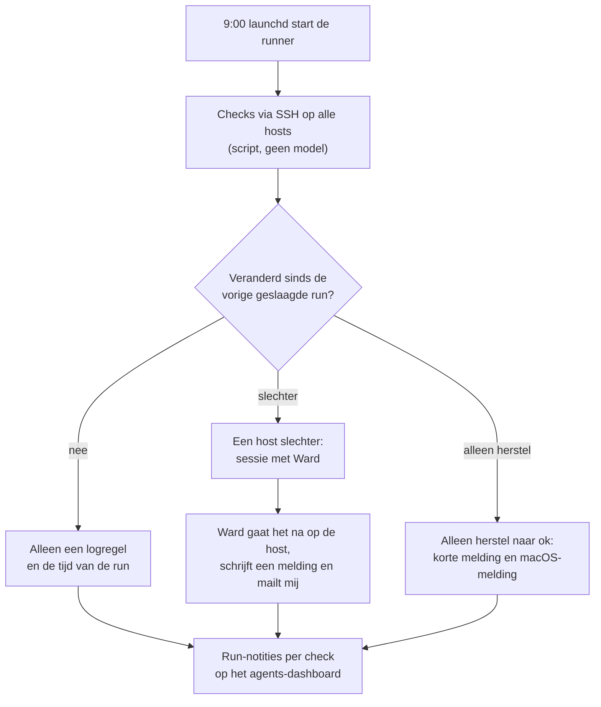

# Ward: bewaking van de hosts

Ward controleert elke ochtend om 9:00 de 20 hosts van Pompkracht (`pompkracht-prd`,
`pompkracht-dev` en `shared-hosting`, de HAProxy-hosts en de k3s-nodes) en waarschuwt mij als er
iets verandert. Het draait op mijn laptop, onder launchd.

De eerste check hoort bij Java4Shell (CVE-2026-114938, PKI-1132): zolang de hosts een CPU zonder
`avx512vbmi` hebben, zijn we niet kwetsbaar. Verschijnt die flag, dan is een hotfix nodig. Later
komen er meer checks bij, zoals schijfruimte, certificaten, kernelversies en back-ups.

## Hoe een run verloopt

1. **Checks.** Een script maakt per host één SSH-verbinding en vergelijkt het resultaat met de
   referentie in `data/ward/baseline.json`. Er is geen model bij betrokken.
2. **Vergelijken.** De runner vergelijkt de uitkomsten met de laatste geslaagde run. Een bekend
   probleem levert niet elke dag opnieuw iets op.
3. **Alleen bij een verandering naar slechter** start een headless sessie met Ward. Ward gaat de
   bevinding na op de host (met een vaste set read-only commando's), schrijft een melding in
   `meldingen/` en mailt mij vanaf de zakelijke Gmail, met `Ward` in het onderwerp. Mail kan alleen
   naar martijn@crimsoncricket.nl.
4. **Alleen herstel naar `ok`:** de runner schrijft zelf een korte melding en geeft een
   macOS-melding, zonder model en zonder mail.
5. **Dashboard.** Per check staat de laatste run op het agents-dashboard
   (`gebieden/agents/dashboard.md`), ook als er niets aan de hand is.

## De checks en hun uitkomsten

| Check | Wat | `warn` | `alarm` |
| --- | --- | --- | --- |
| `hosts` | de hostlijst in `~/.ssh/config` tegenover de referentie | een host erbij of verdwenen | - |
| `cpu` | CPU-model en flags uit `/proc/cpuinfo` | ander model dan Cascadelake, of host onbereikbaar | `avx512vbmi` aanwezig |

Een ander CPU-model zonder VBMI is nog niet gevaarlijk, maar wel een vroeg teken dat TransIP iets
verandert. Alles wat niet `ok` is, blijft als aandachtspunt op het dashboard staan tot de host weer
`ok` is of ik de referentie aanpas.

## Wat ik doe bij een melding

- **`alarm` (`avx512vbmi`):** de hotfix uit PKI-1132 uitrollen: alleen de upgrade van het base
  image, of `JAVA_TOOL_OPTIONS=-XX:-UseBASE64Intrinsics` als er nog geen gepatcht Temurin-image is.
- **`warn`, ander CPU-model:** nagaan wat TransIP veranderd heeft. Is het bewust en veilig, dan pas
  ik `model` in de referentie aan.
- **`warn`, host erbij of weg:** klopt de wijziging in `~/.ssh/config`, dan pas ik `hosts` in de
  referentie aan.
- **`warn`, onbereikbaar:** de host bekijken. Verdwijnt vanzelf zodra de host weer antwoordt.
- **Ward-run mislukt** (`failed` op het dashboard, melding van de watcher): opnieuw starten met
  `launchctl kickstart gui/$(id -u)/nl.crimsoncricket.ward`, of wachten op de volgende ochtend.
  De oude status blijft staan, dus de verandering wordt niet gemist.
- **Ward onder `Stil`** (twee dagen geen run, bijvoorbeeld omdat de laptop uit stond): de runner
  met de hand starten, zoals hierboven.

De referentie pas ik altijd met de hand aan, nooit automatisch.

## Handmatig draaien en testen

- Alleen de uitkomsten bekijken, zonder sessie, status of dashboard:
  `/usr/bin/python3 -I ~/vault/scripts/ward/ward_runner.py --dry-run`. Dit moet ik zelf doen: in
  een Claude-sessie in auto mode is SSH naar de hosts geblokkeerd.
- Een `warn` testen: `--referentie` met een kopie van de referentie met een ander `model`.
- Ward testen met nagemaakte uitkomsten: `--uitkomsten PAD` (JSON `{check: {host: [uitkomst,
  details]}}`). Ward krijgt dan te horen dat het een test is, en `TEST` komt in het onderwerp. Een
  test raakt de echte status alleen met `--status PAD`.
- Een andere check toevoegen: een module in `scripts/ward/checks/` met `NAAM` en
  `check(hosts, referentie)`, een eigen deel in de referentie, en een regel in `CHECKS`.
- De plist gewijzigd: `launchctl bootout gui/$(id -u)/nl.crimsoncricket.ward`, opnieuw kopiëren
  naar `~/Library/LaunchAgents/` en `launchctl bootstrap gui/$(id -u) <plist>`.

## Waar alles staat

| Wat | Waar |
| --- | --- |
| Runner en checks | `scripts/ward/ward_runner.py`, `ssh.py`, `checks/` |
| Referentie | `data/ward/baseline.json` |
| Sessie met Ward | prompt en allowlist in `scripts/ward/headless/`, `nagaan.py` (read-only commando's), `mail_hook.py` (alleen mail aan mij) |
| Schedule | `scripts/ward/nl.crimsoncricket.ward.plist`, geladen in `~/Library/LaunchAgents/` |
| Meldingen (bevindingen en herstel) | `meldingen/ward-<datum>.md` in deze map |
| Run-notities voor het dashboard | `runs/ward-<check>.md` in deze map, niet in git |
| Status, lock en logs | `~/.ward/` (`status.json`, `runner.lock`, `logs/runner.log`, per sessie `logs/<melding>.jsonl`) |
| Agentnotitie voor het dashboard | [[ward]] |
| YouTrack | PKI-1133 (opzet), PKI-1132 (Java4Shell en de hotfix) |

## Openstaand

- PKI-1133 op Done zetten.
- Meer checks: schijfruimte, certificaten, kernelversies, back-ups.
- Het log toont elke dag de hele tabel (ruim 40 regels). Korter maken als het te groot wordt.
- Op het dashboard staat Ward met een rij per check (`cpu`, `hosts`), die op aparte runs lijken.
  Het is één run. Nog beslissen of dat zo blijft of één rij wordt.

## Meer

- [[ward-bewaking-beslissingen]]: waarom het zo werkt.
- [[ward-bewaking-logboek]]: hoe het tot stand kwam.
